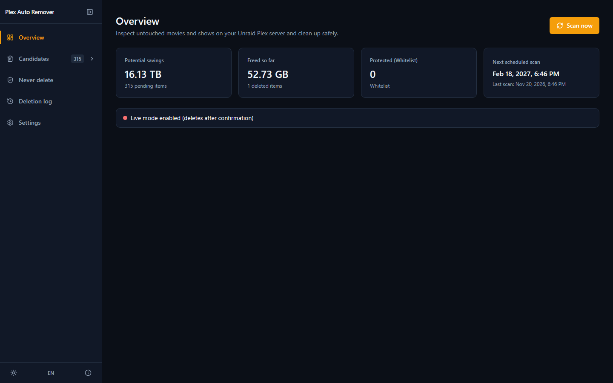
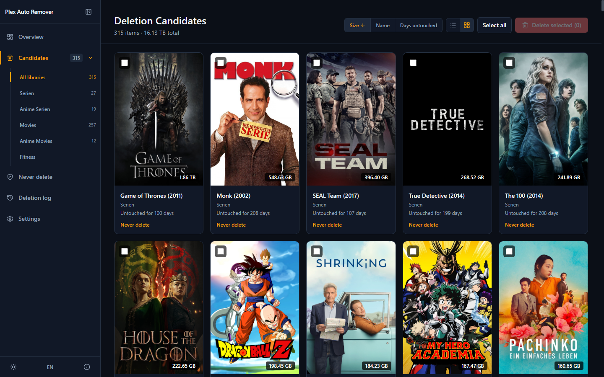

# Plex Auto Remover

**[English](#english) · [Deutsch](#deutsch)**

---

## English

**Plex Auto Remover** is an Unraid Docker application with a modern Web UI that scans your Plex Media Server on a schedule (e.g. every 90 days) for movies and TV shows that have never been watched or have not been touched for a configurable number of days. You review every candidate in the browser, protect favorites permanently, and delete only what you confirm.

### Features
- **Plex API & multi-user watch history:** Evaluates `addedAt`, `lastViewedAt`, and global server playback history across all Plex profiles so media watched by family members is never flagged.
- **Safe review workflow:** Browse candidates as a list or poster grid, filter by Plex library, sort by size, name, or days untouched, and see live freed disk space for your selection.
- **Protection & Dry-Run:** Exclude libraries, tag items with `keep` in Plex, or use the built-in *Never delete* whitelist and optional dry-run mode.
- **Optional Discord reminder:** Receive a webhook notification when a scheduled scan finds untouched media.
- **Bilingual & themeable:** English and German UI with Light and Dark themes.

### Screenshots

### Installation on Unraid

1. **Via Community Applications (or XML template):**
   - Download or reference the template [`templates/plex-auto-remover.xml`](templates/plex-auto-remover.xml).
   - **Web UI Port:** `5281` (mapped to container port `8080`).
   - **AppData Config (`/config`):** Point to a cache or pool drive such as `/mnt/cache/appdata/plex-auto-remover` (recommended for the SQLite database).
   - **Media Share (`/media`):** Mount your Unraid media share (e.g. `/mnt/user/media`) with Read/Write access.
   - **PUID / PGID:** Default `99` / `100` (standard Unraid nobody/users).
2. **First setup in the Web UI:**
   - Open `http://<UNRAID-IP>:5281` and go to **Settings**.
   - Enter your **Plex URL** (e.g. `http://<UNRAID-IP>:32400`) and your **Plex Token** (*Plex Web → any movie → `⋯` → Get Info → View XML → `?X-Plex-Token=...`*).
   - Add **Unraid Path Mappings** matching your Plex container paths to `/media/...` (e.g. `/movies` → `/media/movies`, `/tv` → `/media/tv`).
   - Click **Save** and **Test connection**, then run your first scan from **Overview**.

### Updates on Unraid
Open the **Docker** tab in Unraid, click **Check for Updates**, and then **Update** next to `PlexAutoRemover`.

---

## Deutsch

**Plex Auto Remover** ist ein Unraid-Docker-Container mit moderner Web-GUI, der deinen Plex Media Server regelmäßig (z. B. alle 90 Tage) auf Filme und Serien prüft, die noch nie geschaut oder seit einer konfigurierbaren Anzahl Tage nicht mehr berührt wurden. Du prüfst jeden Treffer bequem im Browser, schützt Lieblingstitel dauerhaft und löschst nur das, was du explizit bestätigst.

### Funktionen
- **Plex-API & Multi-User-Verlauf:** Wertet `addedAt`, `lastViewedAt` sowie die globale Wiedergabe-Historie über **alle** Plex-Profile hinweg aus – damit nichts gelöscht wird, was ein Mitbenutzer kürzlich geschaut hat.
- **Übersichtliche Prüfung:** Listen- und Kachel-Ansicht mit Postern, Bibliotheks-Filter im Baummenü, Sortierung nach Größe, Name oder Tagen unberührt sowie Live-Anzeige des frei werdenden Speicherplatzes.
- **Schutz & Dry-Run:** Ganze Bibliotheken ausschließen, Titel in Plex mit dem Label `keep` versehen oder direkt über *„Nie löschen“* schützen; optionaler Dry-Run-Modus.
- **Optionale Discord-Erinnerung:** Sendet bei neuen Funden auf Wunsch eine kurze Info per Discord-Webhook.
- **Zweisprachig & Themes:** Deutsch und Englisch sowie Helles und Dunkles Design.

### Installation auf Unraid

1. **Über Community Applications (oder XML-Template):**
   - Template [`templates/plex-auto-remover.xml`](templates/plex-auto-remover.xml) verwenden.
   - **Web UI Port:** `5281` (auf Container-Port `8080`).
   - **AppData Config (`/config`):** Auf einen Cache- oder Pool-Pfad legen, z. B. `/mnt/cache/appdata/plex-auto-remover` (wichtig für SQLite).
   - **Media Share (`/media`):** Deinen Unraid-Medien-Share (z. B. `/mnt/user/media`) mit Lese-/Schreibrechten (`rw`) einbinden.
   - **PUID / PGID:** Standard `99` / `100`.
2. **Ersteinrichtung in der Web-GUI:**
   - Öffne `http://<UNRAID-IP>:5281` und gehe auf **Einstellungen**.
   - Trage **Plex-URL** (z. B. `http://<UNRAID-IP>:32400`) und **Plex-Token** ein (*Plex Web → Film → `⋯` → Info abrufen → XML anzeigen → `?X-Plex-Token=...`*).
   - Lege unter **Unraid Pfad-Mapping** die Zuordnung von den Plex-Pfaden auf `/media/...` fest (z. B. `/movies` → `/media/movies`, `/tv` → `/media/tv`).
   - Klicke auf **Speichern** und **Verbindung testen**, und starte deinen ersten Scan über **Übersicht**.

### Updates auf Unraid
In Unraid im Tab **Docker** auf **Check for Updates** klicken und anschließend bei `PlexAutoRemover` auf **Update**.
